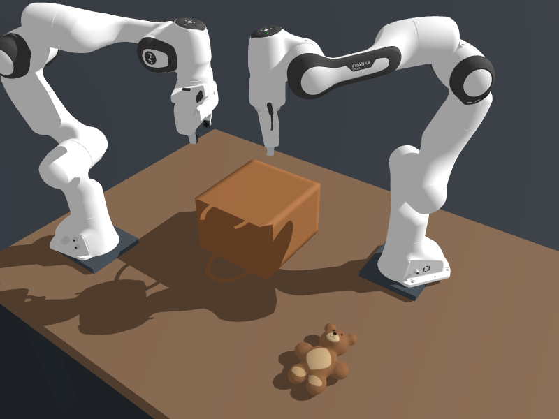
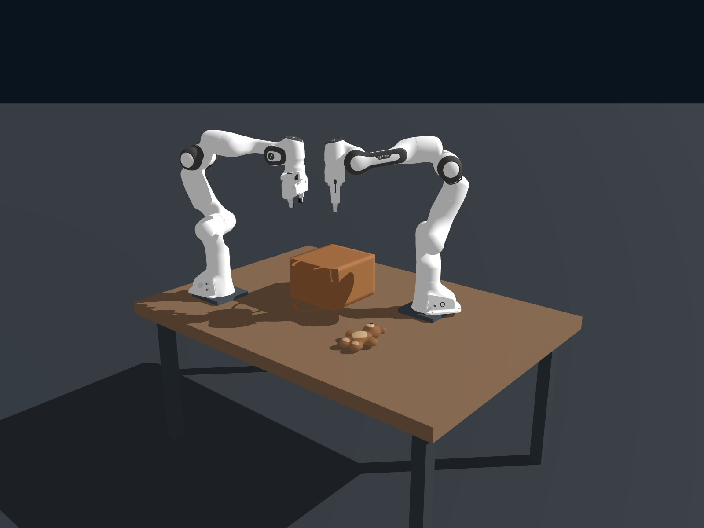
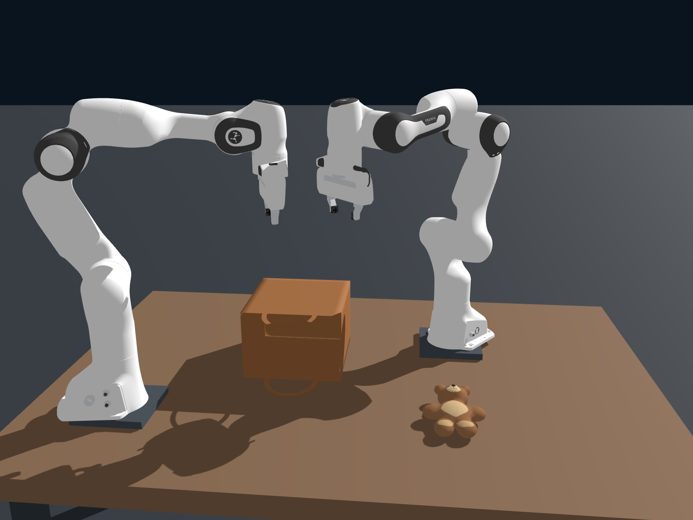
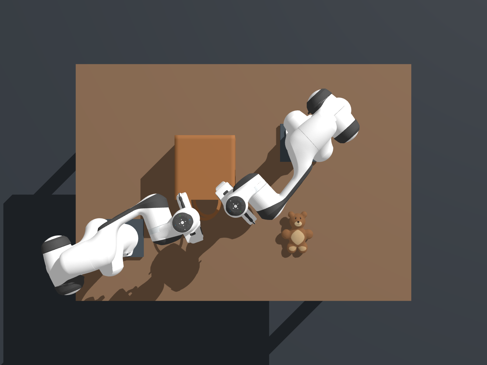
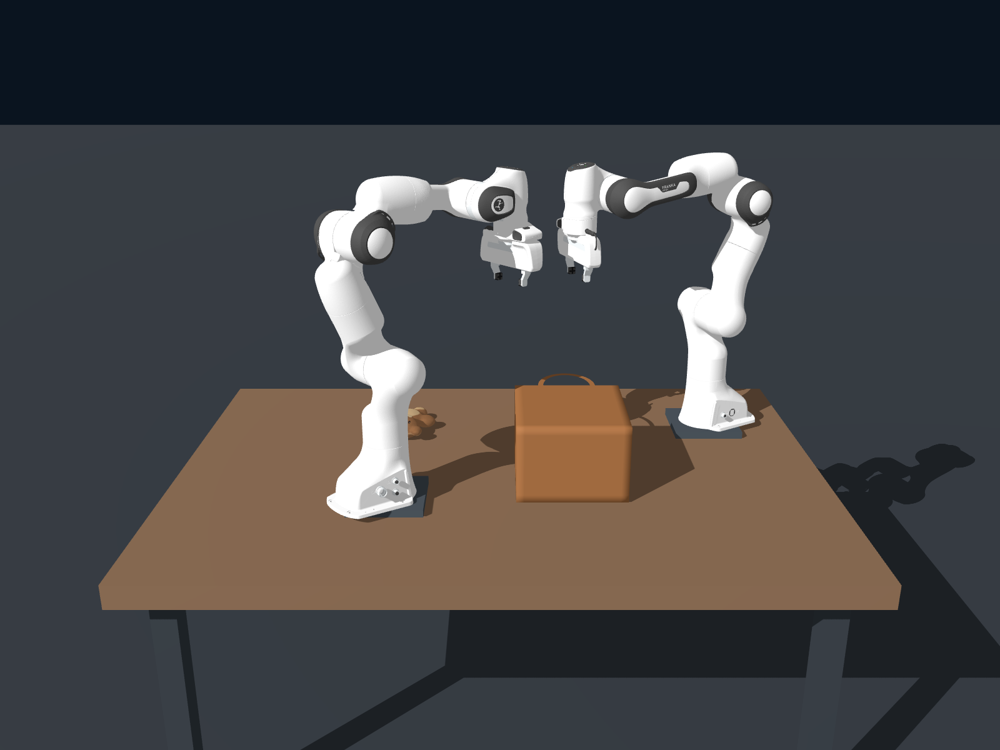
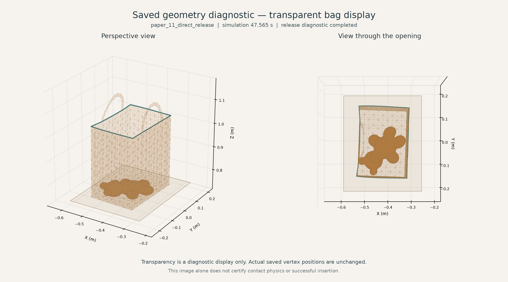

# Genesis 双 Franka 软体熊装袋实验

在 NVIDIA GPU 上运行的桌面操作场景：两台 Franka 机械臂、一个可变形纸袋和一个软体玩具熊。左臂夹住纸袋提手，将侧躺的纸袋扶正并放到桌面；右臂抓起玩具熊，移到袋口上方，随后张开夹爪，让熊落入袋内。

**当前结果：已展示松手落袋，尚未通过完整流程的物理质量验证。** 初始连续运行因熊的局部网格过度压缩而停止；后续从核对一致的保存状态恢复并直接释放，期间出现局部体积单元翻转。原始报告中的 `task_passed=false` 保留。

[](media/full_process.mp4)

[查看完整过程 MP4](media/full_process.mp4) · [最终场景](media/final_scene.png) · [袋内位置诊断图](media/final_inside_bag.png) · [v0.1.0 数据归档](https://github.com/Chloe-Jinlei/genesis-dual-franka-teddy-bagging/releases/tag/v0.1.0)

## 四个初始视角

沿用之前 demo 的四组相机参数，展示本次纸袋场景的 **t=0 初始状态**。四张都是 Genesis 原生 RGB 渲染、1600×1200 PNG；相机视场角均为 42°，没有裁剪、合成或图像修饰。此次仅创建初始场景并渲染，物理步数为 0；纸袋和熊的顶点位置与 `paper_09_full_authorized/rest.npz` 完全一致。

| 01 斜视全景 | 02 正面近景 |
| --- | --- |
| [](media/initial_views/initial_01_oblique.png) | [](media/initial_views/initial_02_front_close.png) |
| **03 俯视** | **04 对侧正面** |
| [](media/initial_views/initial_03_top.png) | [](media/initial_views/initial_04_opposite_front.png) |

[四张原图和相机记录](media/initial_views/) · [下载四视角补充包](https://github.com/Chloe-Jinlei/genesis-dual-franka-teddy-bagging/releases/download/v0.1.0/initial_views.zip) · [相机参数、校验值与零步渲染记录](media/initial_views/initial_views.json)

在下文所述依赖准备好后，可单独渲染到新目录：

```bash
PYTHONPATH="$PWD/vendor" ../.venv/bin/python render_initial_views.py --output new_initial_views
```

此入口只构建初始场景并输出四张图，不会执行运动流程。新加入的相机选项默认关闭，原有运动入口行为不变。Release 原始 `complete_result_bundle.zip` 保留发布时内容；四张新增图片及其渲染入口位于独立的 `initial_views.zip` 补充包和当前仓库。

## 视频与实际完成动作

录像约 55 秒，由两段已有仿真记录和最终位置展示组成。**视频 45.6 秒处是保存状态恢复后的衔接点。** 视频时间包含阶段停留画面，与物理时间并非逐秒相同。

| 视频时间 | 内容 | 对应记录 |
| --- | --- | --- |
| 0–45.6 秒 | 初始桌面场景；夹住提手、提袋、扶正、放回桌面；抓熊、提熊、移向袋口上方 | `paper_09_full_authorized`，物理时间 0–43.765 秒 |
| 45.6–49.8 秒 | 从同一保存状态恢复，右夹爪张开，熊在重力作用下落入袋内，随后观察 | `paper_11_direct_release`，物理时间 43.765–47.565 秒 |
| 49.8–54.8 秒 | 最终保存几何的透明袋壁诊断图 | 静态展示，没有推进仿真 |

左臂在最终状态仍夹着提手。原计划的“机械臂继续下放熊到袋内”和“右臂撤回”没有执行，视频没有补造这两段动作。透明袋壁仅用于看清袋内位置，没有改变物理模型或保存的顶点位置。



## 结果、停止原因与恢复范围

- **原连续运行：** 在第 8753 步、物理时间 43.765 秒，运输尚未结束时停止。一个熊体四面体的当前/初始体积比降到 `0.043714`，低于 `0.05` 的质量阈值。这是局部单元压缩，不代表整只熊体积只剩 4.37%。见 [run09_report.json](results/run09_report.json)。
- **恢复核对：** 直接释放从上述第 8753 帧恢复。软体位置、原生速度及历史数组、刚体状态、机器人关节和耦合状态的已记录读回值与保存值一致。该核对不等于认证“与原进程不间断推进逐步完全等价”。见 [restoration.json](results/restoration.json)。
- **直接释放：** 按后续要求完成松手，不再以局部变形质量阈值中止释放，但保留实际数值。过程中最多有 4 个四面体翻转，最小有符号体积比约 `-0.01647`。因此不能将求解器收敛或视觉落袋解释为物理质量通过。见 [run11_report.json](results/run11_report.json)。
- **最终位置：** 保存的 1450 个熊顶点均被几何检查判为袋内；两侧右夹爪关节各张开至约 `0.040 m`；纸袋拟合倾角约 `0.755°`。该袋内检查对实际袋壁加上仅用于计算的虚拟袋口封面，检查顶点包含关系；它不是材料真实性、整个连续运动或完整网格体积无交叉的证明。

本仓库保留成功动作和失败证据，供复核、调试与后续改进。此版本没有声称完成可靠、可重复的真实物理装袋任务。

## 物理实现

纸袋使用可变形薄壳与弯曲模型，玩具熊使用体积有限元；抓持依靠有限夹爪驱动力、接触和摩擦。Genesis 与原生 IPC 使用 CUDA 后端。软体没有固定节点、理想抓取绑定或通过逐帧写位置实现的搬运；机械臂使用连续轨迹和动力学控制。

纸袋的初始状态是**已经成形且敞口的长方形纸袋侧躺在桌面**，并非完全压扁的折叠纸袋。袋体尺寸约为 `0.28 × 0.20 × 0.30 m`，桌面高度为 `0.74 m`。

材料参数是未经实物测量校准的工程近似。纸袋采用等效各向同性弹性纸壳，不含永久折痕、撕裂、纤维方向或湿度影响；提手用纸条薄壳近似。玩具熊的外皮和填充被合并为均匀可压缩软体。具体参数、模型选择和局限见 [config.json](config.json) 与 [docs/](docs/)。

## 仓库内容

| 路径 | 内容 |
| --- | --- |
| `run.py`、`run.sh`、其他根目录 Python 文件 | 场景、运动控制、验证、状态保存与结果整理代码 |
| `release_saved.py`、`restore_rigid_state.py` | 本次保存状态恢复与直接释放的开发实现；不是通用或已认证的精确续算接口 |
| `config.json`、`assets/` | 场景参数、纸袋与熊网格、机器人资源 |
| `media/` | 合成过程录像、四个初始视角、原初始细节图与两张最终结果图 |
| `results/` | 原运行、直接释放及恢复核对报告 |
| `docs/` | 材料、保存、后续运行与结果说明 |
| `requirements.lock.txt` | 已观察到的 Python 包版本清单，不是 wheel 哈希锁定文件 |
| [Release v0.1.0](https://github.com/Chloe-Jinlei/genesis-dual-franka-teddy-bagging/releases/tag/v0.1.0) | 较大的运行数据与保存归档 |

原始状态、日志、检查点、运行时依赖和历史源码以 Release 归档内的目录、清单与说明为准。根目录代码可能包含运行后的保存或展示改进；重放特定历史尝试时，应使用该次运行保存的 `source/` 与同级配置，并复制到新目录操作。

## 运行环境与复现说明

已使用的本机环境如下。这是运行记录，不是所有兼容硬件的最低配置承诺。

| 项目 | 已记录版本或配置 |
| --- | --- |
| 系统 / Python | Linux x86_64、glibc 2.39、Python 3.12.15 |
| GPU | NVIDIA GeForce RTX 5070 Laptop GPU，约 8 GB 显存 |
| NVIDIA 驱动 | 595.99.02 |
| Genesis | 1.4.3，本地实际源码版本与修改记录见归档 |
| 原生 IPC | libuipc / `pyuipc 0.0.29` |
| PyTorch | `2.14.0+cu130`，CUDA 构建 13.0 |
| MuJoCo | 3.15.0，用于运动规划与运动学相关工具 |

`run.sh` 默认读取**仓库父目录**的 `.venv/bin/python`，并把当前场景的 `vendor/` 加入该进程的 Python 搜索路径；若存在 `continuation/native_vendor/uipc`，也支持该归档布局。它不会自动创建环境或安装原生 IPC，当前场景没有 CPU 仿真回退。

开始新运行前，需要准备兼容的 Python 环境、CUDA 驱动与 PyTorch 构建，并恢复匹配的 Genesis 实际源码、IPC 原生依赖和模型文件。单独克隆仓库或执行 `pip install -r requirements.lock.txt` 不足以保证可运行。完整虚拟环境及离线 wheel 集合不在归档中；原生库还受 Python ABI、glibc 和驱动兼容性约束。尚未验证干净机器安装或跨机器复现。

在上述环境已准备好的前提下，从初始状态启动新的全流程尝试：

```bash
bash run.sh --headless --config config.json --task full --output rerun_new_001 --wall-seconds 1800
```

输出名称应使用未占用的新名称；图形界面可将 `--headless` 换为 `--viewer`。该命令启动新仿真，不会自动重现视频中的“停止后恢复并直接松手”过程，也不保证修复本版本已记录的失败。支持的阶段与参数见代码入口；恢复与历史重放请先阅读 [docs/](docs/) 和 Release 说明。

第三方机器人网格及依赖保留各自的来源与许可说明；使用或再分发时请同时查看对应资源目录中的文件。

来源与许可说明见 [THIRD_PARTY_NOTICES.md](THIRD_PARTY_NOTICES.md)。
